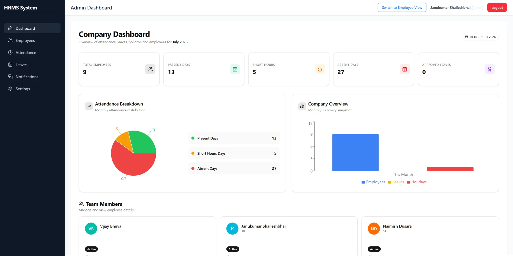
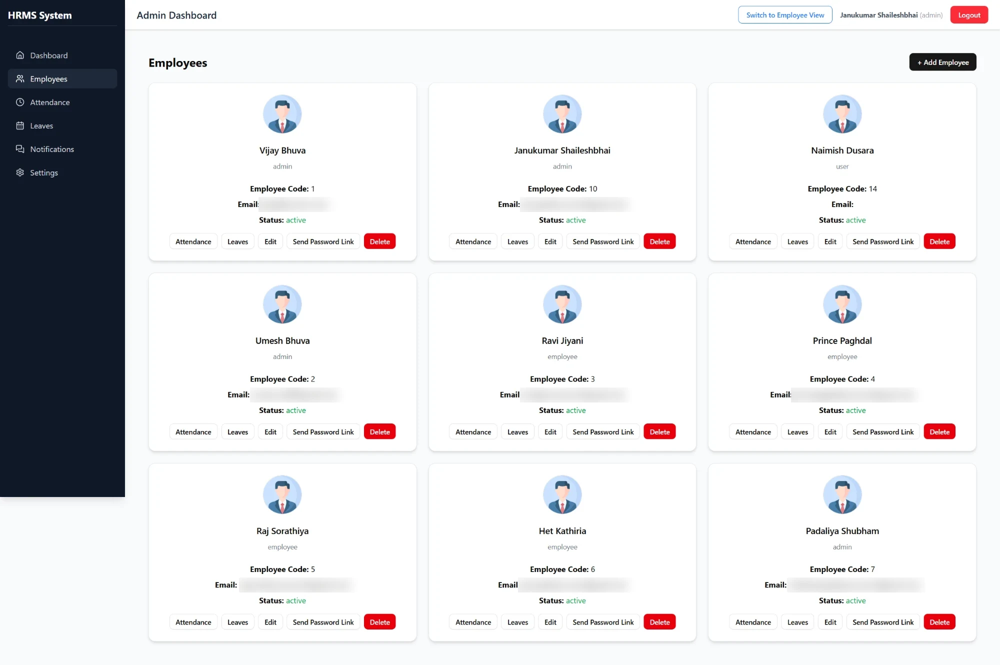
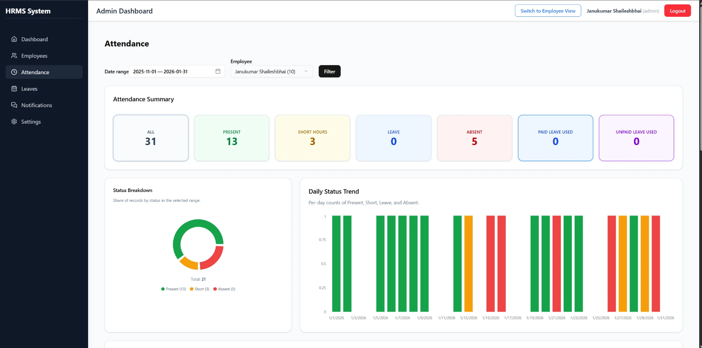
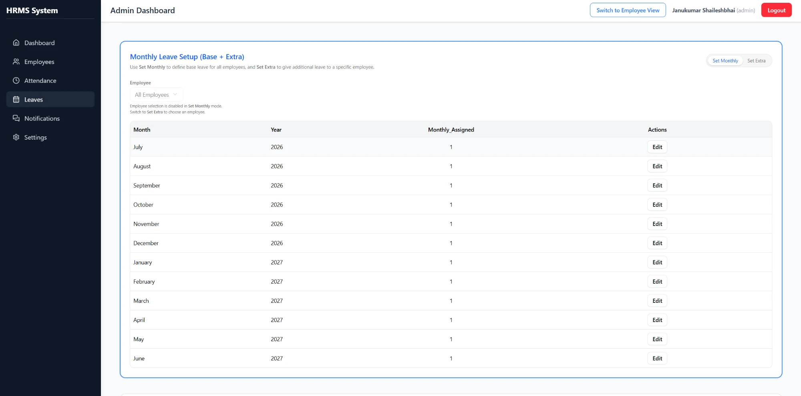
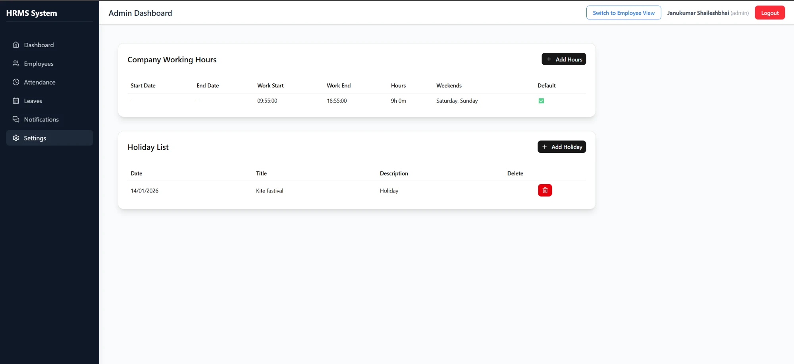
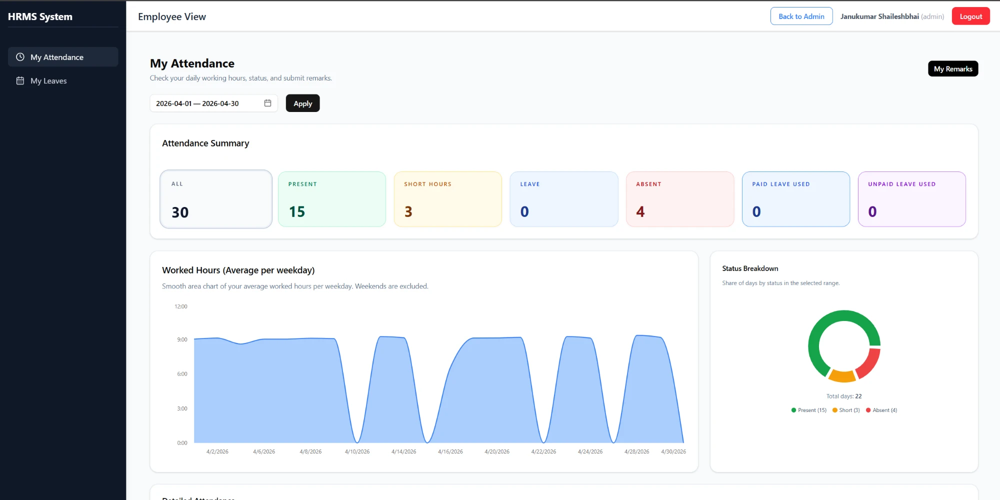
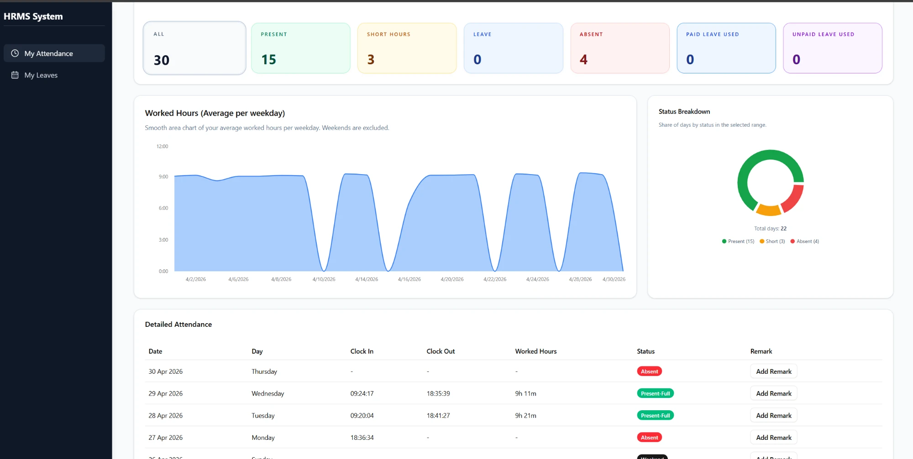
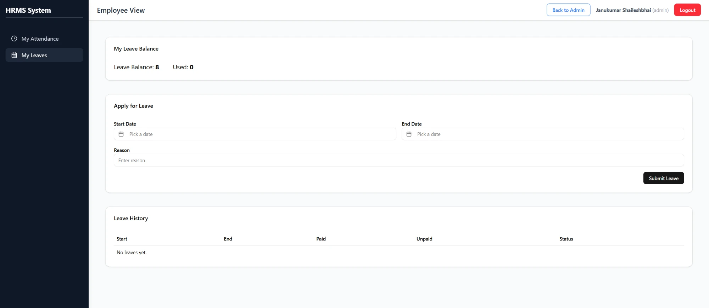

# HRMS & Attendance Management System (Frontend)

A React dashboard for managing employee attendance, leaves and company working rules. Admins get a company-wide view of attendance, employees and leave approvals. Employees get their own attendance history, leave balance and a way to add remarks on their records.

Attendance data reaches the app with no manual entry: an n8n workflow reads the recurring attendance emails, stores the records in PostgreSQL, and a Node.js/Express API serves them to this frontend.

```
Attendance email  →  n8n workflow  →  PostgreSQL  →  Node.js / Express API  →  React dashboard (this repo)
```

## Screenshots

### Admin: Company Dashboard
Monthly overview of employees, present days, short-hour days, absences and approved leaves, with attendance breakdown and team members.



### Admin: Employees
Add, edit and remove employees, assign roles (admin / employee), and send a set-password link by email. Jump straight to any employee's attendance or leaves.



### Admin: Attendance
Filter by date range and employee to see a status summary, status breakdown and a day-by-day status trend.



### Admin: Monthly Leave Setup
Set a base monthly leave allowance for all employees (**Set Monthly**) or give extra leave to one employee (**Set Extra**).



### Admin: Company Settings
Configure working hours, required hours per day, weekends and the company holiday list.



### Employee: My Attendance
Each employee sees their own summary, average worked hours per weekday and status breakdown for any date range.



Daily records show clock-in, clock-out, worked hours and status, and employees can add a remark to any day for the admin to review.



### Employee: My Leaves
Leave balance, leave application form and leave history.



## Features

**Admin**
- Company dashboard with monthly attendance KPIs and charts
- Employee management: add, edit, delete, role assignment, emailed set-password links
- Attendance reports filtered by date range and employee
- Leave approval (approve / reject) and monthly base + extra leave allocation
- Review employee remarks on attendance records (accept / reject)
- Company working hours, weekends and holiday calendar
- Switch to the employee view without logging out

**Employee**
- Personal attendance summary, worked-hours chart and daily records
- Remarks on individual attendance days
- Leave balance, leave requests and leave history

**Status rules**: each day is classified as *Present*, *Short Hours*, *Leave*, *Absent* or *Weekend* using the company's configured working hours, weekends and holidays.

## Tech Stack

| Area | Tools |
|------|-------|
| Framework | React 19, Vite 7 |
| State | Redux Toolkit, React Redux |
| Routing | React Router 7 with protected, role-based routes |
| UI | Tailwind CSS 4, shadcn/ui (Radix UI), Lucide icons, Sonner toasts |
| Charts | Recharts, Chart.js |
| API | Axios with a JWT interceptor and automatic logout on expired sessions |
| Dates | date-fns, Day.js, React Day Picker |

## Getting Started

**Requirements:** Node.js 18+ and the HRMS backend API running.

```bash
git clone https://github.com/Pateljanu/hrms-hikvision-integration-frontend.git
cd hrms-hikvision-integration-frontend
npm install
```

Create a `.env.local` file with the backend URL (defaults to `http://localhost:5000` if not set):

```
VITE_API_URL=http://localhost:5000
```

Run the app:

```bash
npm run dev
```

Build for production:

```bash
npm run build
```

## Project Structure

```
src/
├── api/            # Axios instance, auth header and error handling
├── app/            # Redux store
├── components/     # Layout, Navbar, Sidebar, ProtectedRoute, shadcn/ui components
├── features/       # Redux slices and thunks: auth, attendance, employees,
│                   # leaves, holidays, remarks, company settings
├── pages/          # Dashboard, Employees, Attendance, LeaveApproval, MyLeaves,
│                   # EmployeeAttendance, CompanySettings, AdminRemarks, Login, SetPassword
└── lib/            # Shared helpers
```

## Author

**Janukumar Fefar** · Full-Stack Developer (Node.js, React.js, PostgreSQL)
[LinkedIn](https://linkedin.com/in/fefar-janu-3005a4279)
